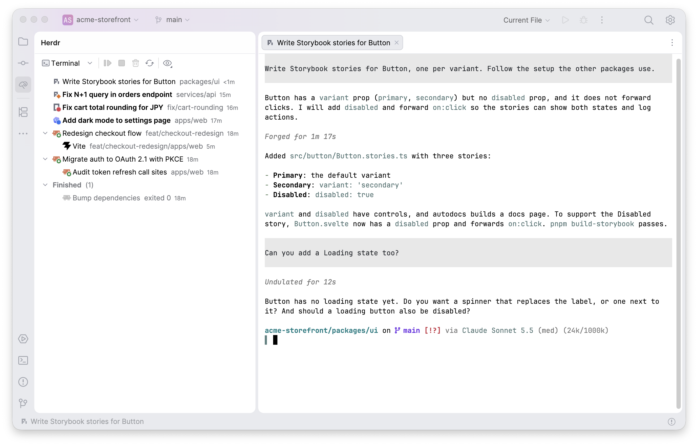

# Herdr Session Manager

An IntelliJ plugin that lists the [herdr-core](https://herdr.dev/core/) terminals of the open project in a sidebar and opens them in editor tabs. It is not affiliated with the herdr project.



## Requirements

- IntelliJ IDEA 2026.2 (build 262) or later.
- herdr-core (`hc`) 0.1.16 or later. Settings > Tools > Herdr can install and update it.
- Optional: an agent integration that writes [labels](#labels-and-agent-integrations). Without one, Resume and session titles do not work, and the plugin shows only the blocked states that the agent reports to core.
- Rust (`cargo`), to build the `herdr-attach` helper.

## How it works

```
agent + integration ──hc label──► herdr-core ◄──hc connect── plugin sidebar
                                      ▲                          │
                                      └──── hc run/send/kill/rm ─┘
```

- The agent runs in a herdr-core terminal and reports its status to core.
- An agent integration writes labels on the same terminal with `hc label`.
- The plugin subscribes to core events with `hc connect` and shows the terminals whose cwd is under the project, one of its git worktrees, or an extra folder from Settings > Tools > Herdr > Scope. Child terminals of these terminals show too.
- Opening a row runs `hc attach` in an editor tab. Ctrl+\ closes the tab, and the program keeps running.
- Sidebar actions (New session, Resume, Finish, Delete, Clear Blocked) call `hc run`, `hc keys`, `hc send`, `hc kill`, `hc rm` and `hc label`.

## Sidebar

The Herdr tool window is on the right side of the IDE.

- **Rows:** each row shows the program icon and a status mark: an orange diamond for blocked, a red dot for error, a blue dot for unread and a green ring for running. Child terminals show under their parent. Finished terminals are in the Finished group.
- **Unread:** an agent that is done stays unread until you select its editor tab.
- **Single click or arrow keys:** show a live terminal without focus, when Enable Preview Tab or Open Files with Single Click is on in the Project view options. With Enable Preview Tab, the terminal opens in the preview tab. Type in a preview tab to keep it.
- **Double-click or Enter:** opens the terminal. On a resumable row, it runs Resume. A setting can turn this off.
- **Toolbar:** the first button starts the default agent in the project folder. The arrow next to it lists Terminal (a login shell) and the agents of the Herdr app's program table. `~/.config/herdr-app/programs.json` changes their names and commands. Then come Resume, Finish (ends the program), Delete (ends the program and removes the terminal), Refresh Worktrees and View Options.
- **View Options:** Group By > Directory groups the rows by folder. Sort By > Recent (default) puts the last status change first. Sort By > Status orders the rows as blocked, error, unread, running, idle, then the rest.
- **Context menu:** Resume, Finish, Delete, Mark as Read, Mark as Unread, Clear Blocked, Copy (Address, Attach Command, Working Directory, Resume Command, Session File), Select in Project View, Reveal in Finder (the name changes with the OS) and Open in Terminal.
- **Several rows:** Resume, Finish, Delete, Mark as Read, Mark as Unread, Clear Blocked and Copy act on all selected rows. Enter opens all of them. Select in Project View, Reveal in Finder and Open in Terminal need exactly one selected row.

## Settings

Settings > Tools > Herdr:

- **herdr-core:** the `hc` executable. When it is empty, the plugin searches `PATH`, then `~/.local/bin/hc` and `~/.local/bin/herdr-core`. Install and Update run the official installer into `~/.local/bin`. They are available only for an `hc` in that folder. "Check for herdr-core updates every 3 hours" (on by default) shows a notification for a new release, with a Skip this version action. A missing or too old `hc` shows a notification also when this is off.
- **Sessions:** "Default agent" (default Terminal), "Double-click or Enter on a resumable row resumes it" (on) and "Confirm before Finish and Delete" (on).
- **Sidebar:** "Show the folder or worktree branch" (on) and "Show the time since the last status change" (on).
- **Labels:** the label keys. See [Labels and agent integrations](#labels-and-agent-integrations).

Settings > Tools > Herdr > Scope holds extra folders for each project. Terminals in these folders show in the sidebar too. The list is kept in `.idea/workspace.xml`.

## Labels and agent integrations

The plugin reads these terminal labels. They are a convention of this plugin, not of herdr. The keys can be changed in the Labels group of Settings > Tools > Herdr, and an empty key turns the feature off.

| Key | Value | Effect in the plugin |
|---|---|---|
| `resume` | Shell command that reopens the agent session | Enables Resume when the agent has exited or the terminal is finished, for example after a reboot. Resume types the command into the shell. For a finished terminal, it runs the command in a new terminal and removes the finished one. |
| `title` | Session name | Row label and editor tab name. |
| `blocked` | Question that waits for the user | Shows the row of a live agent as blocked, with the question as its message. Write an empty value when the question is answered. |

Do not use the Herdr app's keys (`herdr.space`, `herdr.tab`, `where`).

[`docs/agents/`](docs/agents/README.md) has example integrations for pi, Claude Code, Codex and OpenCode.

## Build and install

```sh
./gradlew buildPlugin            # zip in build/distributions/
./gradlew runIde                 # sandbox IDE
./gradlew check verifyPlugin     # tests, helper tests, detekt, ktfmt, plugin verifier
scripts/install-local.sh         # build, quit IntelliJ, install, restart it if it ran (macOS)
```

The `herdr-attach` helper is built for the targets in `helperTargets` in `gradle.properties` (default `aarch64-apple-darwin`). Supported targets are `aarch64-apple-darwin`, `x86_64-apple-darwin`, `aarch64-unknown-linux-gnu` and `x86_64-unknown-linux-gnu`, as a comma-separated list. Without it, kitty graphics show as base64 text.

## Limits

- Resume of a live terminal types the command with `hc send`, into whatever reads input at that moment.
- IntelliJ shows no terminal images. See [Terminal identity and shared sessions](docs/terminal-identity.md).
- The plugin uses IntelliJ's experimental Reworked Terminal API.

## License

[Apache License 2.0](LICENSE). Bundled third-party files keep their own licenses. See [THIRD-PARTY-NOTICES.md](THIRD-PARTY-NOTICES.md).
